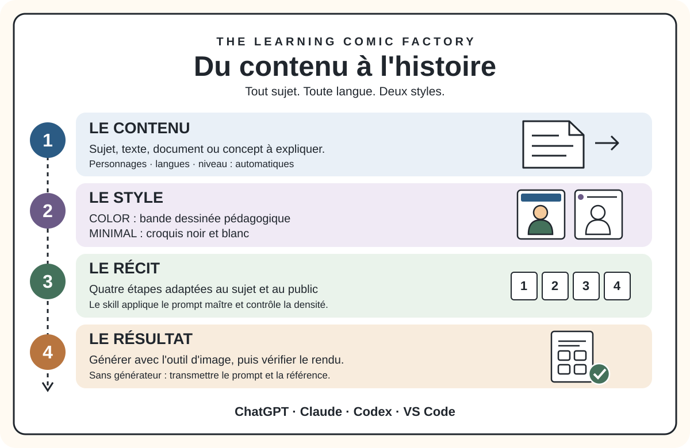
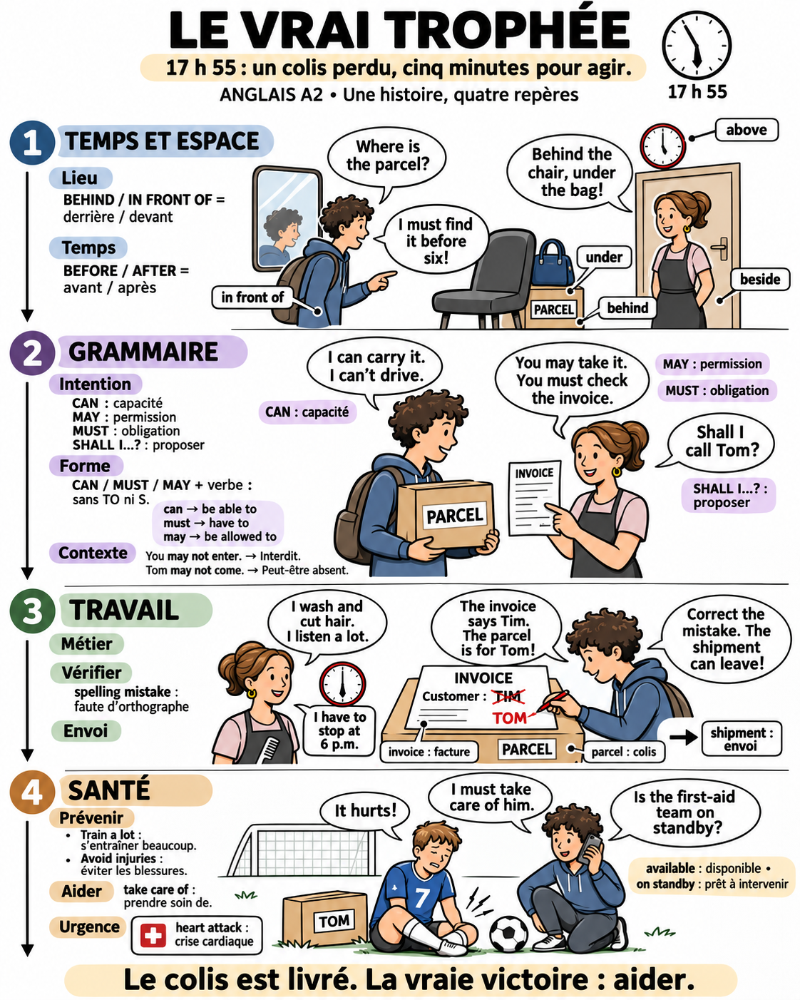
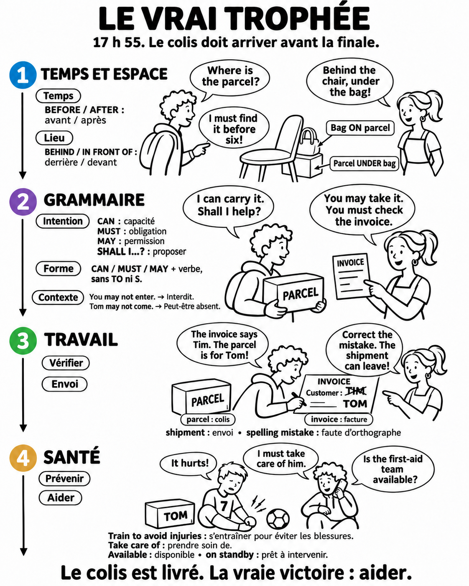

<div align="center">

# 🎨 Infographic Storytelling — COLOR / MINIMAL

**Transformez n'importe quel sujet, dans n'importe quelle langue, en une histoire visuelle mémorable.**

`v1.1.0` · `Universal Edition` · `Agent Skill` · `COLOR / MINIMAL` · `4 chapitres`

[Guide d'installation](PLAYBOOK.md) · [Skill](skills/infographic-storytelling/SKILL.md) · [ChatGPT](https://chatgpt.com/plugins/plugins_6afdb349f2d48191bc61f65e9da016e1)



</div>

## Deux styles. Une seule méthode.

| 🎨 COLOR | ✏️ MINIMAL |
|---|---|
| [](skills/infographic-storytelling/assets/color.png) | [](skills/infographic-storytelling/assets/minimal.png) |
| Bande dessinée pédagogique en couleurs naturelles | Croquis au trait noir, quatre cercles colorés |
| Palette fixe bleu, violet, vert, ocre | Minimum de distractions visuelles |
| [Prompt maître COLOR](skills/infographic-storytelling/references/color.md) | [Prompt maître MINIMAL](skills/infographic-storytelling/references/minimal.md) |

Chaque mode conserve une structure verticale 4:5, quatre chapitres, un protagoniste ou sujet central récurrent, des dialogues courts et une résolution narrative. Les termes requis doivent rester présents ; si la leçon est trop dense, le skill propose une série plutôt qu'une affiche illisible.

## ⚡ Démarrage rapide

Dans ChatGPT, Claude ou votre agent de code compatible, sélectionnez le skill et écrivez simplement votre demande en langage naturel :

```text
COLOR — Explique le fonctionnement d'une API REST.
MINIMAL — Résume ce document.
COLOR — اشرح كيفية عمل القلب
MINIMAL — Explain photosynthesis.
```

**Aucun formulaire, aucun paramètre obligatoire.** Sélectionnez COLOR ou MINIMAL et fournissez votre contenu, sujet ou fichier. Sans style précisé, COLOR est utilisé automatiquement. Le nombre de personnages, les langues, le public, le niveau, les concepts essentiels et le scénario sont déduits du contexte. La langue demandée prime ; sinon celle du contenu est utilisée, ou celle de la demande en cas de contenu mixte ou absent. Tous les sujets sont acceptés, y compris les procédures, les sciences, le développement informatique, l'histoire et les langues. Les préférences explicites restent prioritaires.

## Installation

| Environnement | Méthode |
|---|---|
| ChatGPT Web / Windows | Plugin privé pour son propriétaire ou adaptation du package |
| Gemini Web | [Compétence Gemini — ZIP natif](gemini/README.md) |
| Claude Web / Desktop | Importer le dossier skill compressé |
| Claude Code / VS Code | Copier le skill dans `~/.claude/skills/` |
| Codex / VS Code | Copier le skill dans `~/.agents/skills/` |

Voir le [playbook](PLAYBOOK.md) pour les commandes et les prérequis. La disponibilité dépend du compte et du client. GitHub héberge les sources, mais ne déploie pas automatiquement un plugin cloud. Un générateur d'images compatible est nécessaire au rendu.

## Organisation

```
plugin.json
.codex-plugin/plugin.json
README.md
PLAYBOOK.md
install-windows.ps1
docs/workflow.svg
skills/infographic-storytelling/
  SKILL.md
  assets/color.png
  assets/minimal.png
  references/color.md
  references/minimal.md
```

**Références visuelles :** les deux PNG originaux sont inclus dans le dépôt et dans le plugin privé. Leur intégrité a été vérifiée par comparaison des empreintes Git. Utiliser la référence correspondant au style choisi ; si le générateur ne reçoit pas automatiquement l'image, la joindre manuellement.

## Qualité pédagogique

- Vérifier l'exactitude des termes et la lisibilité.
- Maintenir le nombre de personnages et les quatre chapitres.
- Ne jamais remplacer la vérification par une promesse de fidélité pixel à pixel.
- Si aucun outil d'image n'est disponible, produire un prompt complet et indiquer la référence.

---

<div align="center">Conçu pour apprendre par l'action, pas par la mémorisation mécanique.</div>
